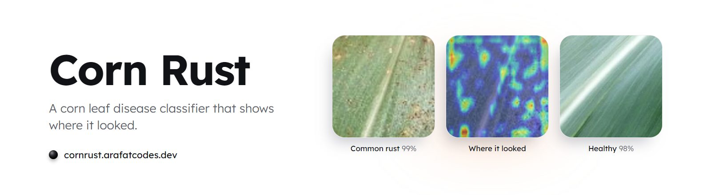
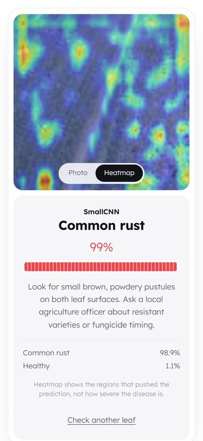
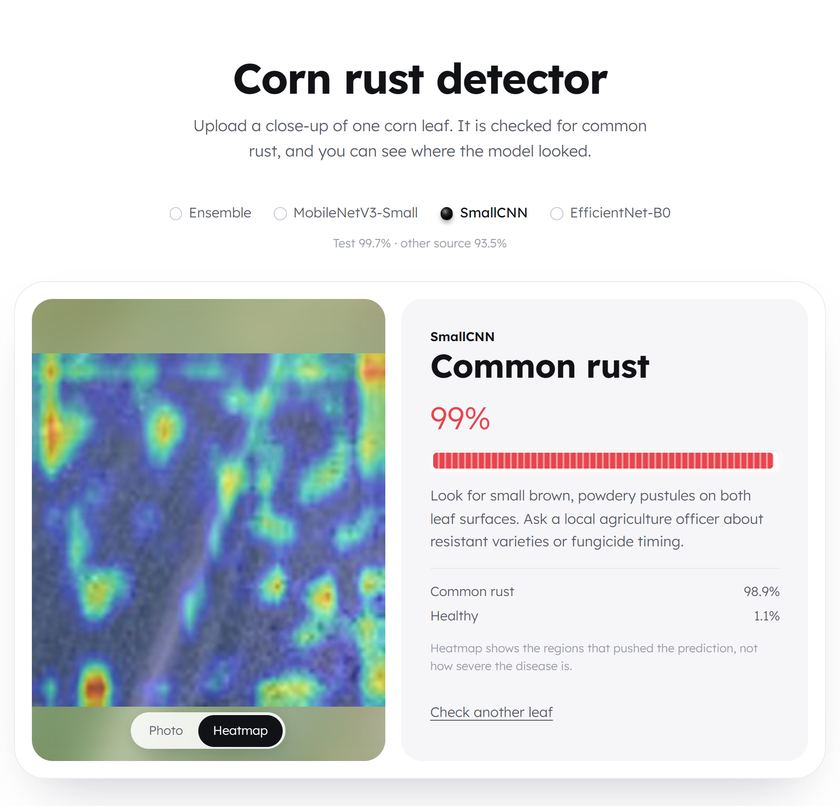
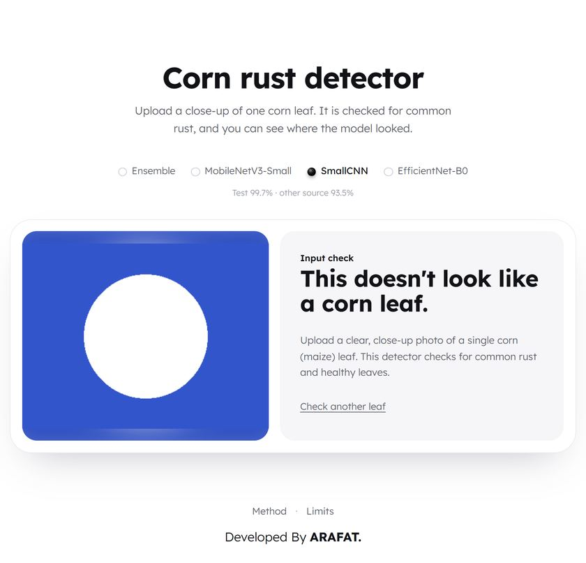
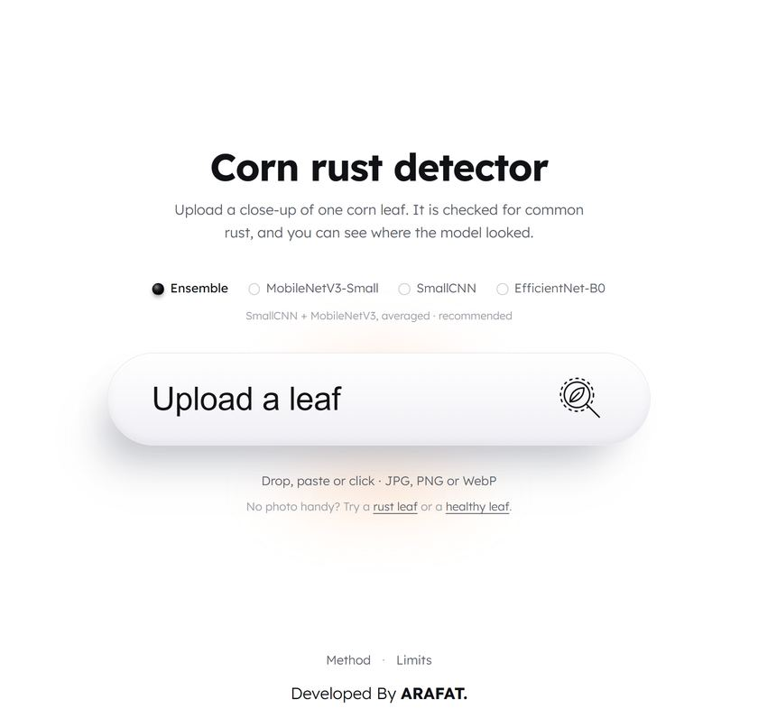
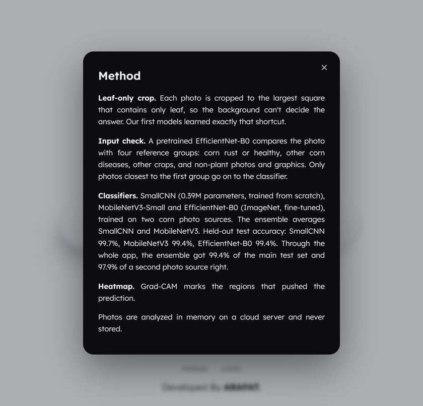
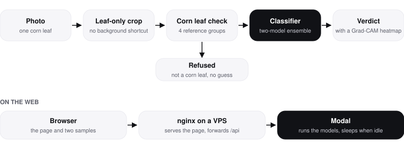
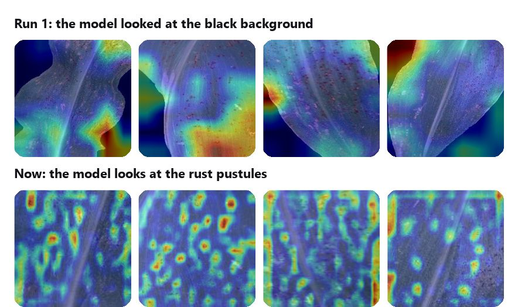

<p align="center">
  <a href="https://cornrust.arafatcodes.dev"></a>
</p>

<h1 align="center">Corn Rust</h1>

<p align="center">A corn leaf disease classifier that shows where it looked</p>

<p align="center">
  
  
  
  
  
</p>

<p align="center"><b><a href="https://cornrust.arafatcodes.dev">cornrust.arafatcodes.dev</a></b></p>

<hr>

<h3 align="center">About</h3>

<table align="center">
  <tr>
    <td>
      <table>
        <tr><td>🎓 <b>Course</b></td><td>Deep Learning</td></tr>
        <tr><td>🧠 <b>Models</b></td><td>SmallCNN, MobileNetV3, EfficientNet-B0</td></tr>
        <tr><td>🌽 <b>Data</b></td><td>Bangladeshi corn leaf photos from two sources</td></tr>
        <tr><td>⚡ <b>Live demo</b></td><td><a href="https://cornrust.arafatcodes.dev">cornrust.arafatcodes.dev</a></td></tr>
        <tr><td>👥 <b>Made by</b></td><td>Md. Arafat Hosen and team</td></tr>
      </table>
    </td>
    <td align="center">
      
    </td>
  </tr>
</table>

<p align="justify">
Common rust is a fungal disease of corn that covers the leaves in small brown, powdery pustules. Farmers
usually spot it by eye, but a mild case is easy to miss. This project trains small image models to tell a
rusty corn leaf from a healthy one from a single photo, and every answer comes with a heatmap that shows
which part of the leaf decided it.
</p>

<p align="justify">
A model with two classes will put a label on anything, even a logo. So before a photo reaches the
classifier, a check compares it with four groups of reference images and refuses everything that is not a
corn leaf. The demo works in any browser and on a phone, and photos are analyzed in memory and never
stored.
</p>

<hr>

<h3 align="center">Screenshots</h3>

<table align="center">
  <tr>
    <td align="center"><br><sub>A rust leaf and where the model looked</sub></td>
    <td align="center"><br><sub>Anything that is not a corn leaf is refused</sub></td>
  </tr>
  <tr>
    <td align="center"><br><sub>One page, four models to choose from</sub></td>
    <td align="center"><br><sub>How it works, in plain words</sub></td>
  </tr>
</table>

<hr>

<h3 align="center">How It Works</h3>

<p align="center">
  
</p>

<p align="justify">
Every photo is first cropped to the largest square that contains only leaf. The corn leaf check then turns
the photo into features with a pretrained EfficientNet-B0 and finds the five closest images in each of four
groups: corn with rust or healthy, corn with other diseases, leaves of other crops, and non plant photos and
graphics. Only a photo that is closest to the first group goes on. The default classifier averages two
models, a small CNN with 0.39M parameters trained from scratch and a MobileNetV3 pretrained on ImageNet and
fine tuned on our photos. Grad-CAM draws the heatmap, and when the models are less than 75% sure the page
says so instead of guessing.
</p>

<hr>

<h3 align="center">What We Found</h3>

<p align="center">
  
</p>

<p align="justify">
Our first models scored 100%, and that was the problem. Almost every rust photo in the main dataset was a
leaf cut out on a black background, while the healthy photos were not, so the models learned to look for
black corners instead of disease. The heatmaps gave it away. Cropping every image to leaf only removed the
shortcut, and the heatmaps moved onto the pustules.
</p>

<p align="justify">
The second trap was a single photo source. After the fix the models still scored over 97% on their own test
set, but SmallCNN got only 65.6% of the corn photos from another dataset right. Training on both sources
lifted it to 93.5%, and MobileNetV3 reached 98.9%. The corn leaf check had a gap too: flat graphics such as a blue logo slipped through, so we added
generated logos, gradients and abstract wallpapers to the non plant group, and now none of them pass.
</p>

<p align="justify">
At the end we rebuilt the whole dataset from the original downloads on a cloud machine. It reproduced the
original split image for image, so the retrained models could be compared with the old ones fairly.
EfficientNet-B0 improved a lot and the other two did not, so the site serves whichever version of each model
did better.
</p>

<table align="center">
  <tr><th align="left">Model</th><th>Parameters</th><th>Main test</th><th>Second source</th></tr>
  <tr><td>SmallCNN, from scratch</td><td align="center">0.39M</td><td align="center">99.7%</td><td align="center">93.5%</td></tr>
  <tr><td>MobileNetV3-Small, fine tuned</td><td align="center">1.5M</td><td align="center">99.4%</td><td align="center">98.9%</td></tr>
  <tr><td>EfficientNet-B0, fine tuned</td><td align="center">4.0M</td><td align="center">99.4%</td><td align="center">96.8%</td></tr>
  <tr><td><b>The whole app</b>, check and ensemble</td><td align="center"></td><td align="center"><b>99.4%</b></td><td align="center"><b>97.9%</b></td></tr>
</table>

<p align="justify">
The main test set holds 339 photos the models never saw in training, and the second source holds 96 corn
photos from a different dataset. The last row counts every photo, including the few the check refused.
</p>

<hr>

<h3 align="center">The Live Demo</h3>

<p align="justify">
The page is a set of static files served by nginx on a small VPS. The two sample leaves come with saved
results, so they open instantly. An uploaded photo goes to a small API on <a href="https://modal.com">Modal</a>
that runs the models on two CPU cores, because these models are small enough to need no GPU. The server
shuts down when nobody uses it and takes about 15 seconds to wake up, so the page starts waking it as soon
as the pointer reaches the upload button. At most two servers run at the same time, which keeps the cost
close to zero.
</p>

<h3 align="center">Built With</h3>

<p align="center">
  
</p>

<hr>

<h3 align="center">Run It</h3>

```bash
git clone https://github.com/arafat0924/corn-rust.git
cd corn-rust
pip install torch torchvision --index-url https://download.pytorch.org/whl/cpu
pip install timm fastapi uvicorn python-multipart pillow scipy matplotlib
python scripts/download_models.py    # about 40 MB of trained models from the v2.0 release
python app/app.py                    # then open http://127.0.0.1:7860
```

<p align="justify">
The <code>scripts</code> folder holds the data pipeline: it downloads the datasets, labels them, removes
near duplicates with perceptual hashing, makes the splits, builds the corn leaf check and evaluates the
whole app. <code>notebooks/train_corn_rust.py</code> trains the three models. <code>deploy/modal_pipeline.py</code>
runs every step in the cloud, from the downloads to GPU training, and <code>deploy/modal_api.py</code> is the
live API. The <code>results</code> folders keep the numbers, learning curves, confusion matrices and heatmaps
of every training run, so no number in this file has to be taken on trust.
</p>

<hr>

<h3 align="center">Data and References</h3>

<p align="justify">
The datasets are not included. The main corn photos come from the
<a href="https://www.kaggle.com/datasets/nafishamoin/bangladeshi-crops-disease-dataset">Bangladeshi Crops Disease Dataset</a>
and the second source is <a href="https://www.kaggle.com/datasets/musfiqurtuhin/bangladeshi-crops-disease-dataset-bcdd">BCDD</a>
(CC BY 4.0), both on Kaggle. The leaves of other crops come from the Mendeley datasets Dhan-Shomadhan,
RiceLeafBD and Plant Leaf Freshness. The heatmaps follow Grad-CAM by Selvaraju et al., ICCV 2017, and the
pretrained weights come from timm. The models have not been tested on new field photos yet, so they are a
course project and not a replacement for an agriculture expert.
</p>

<p align="justify">
<sub>Font in the banner and on the page: Lexend, under the SIL Open Font License.</sub>
</p>

<hr>

<p align="center">Made for the Deep Learning course by <b>Md. Arafat Hosen</b> and team 🌽</p>
